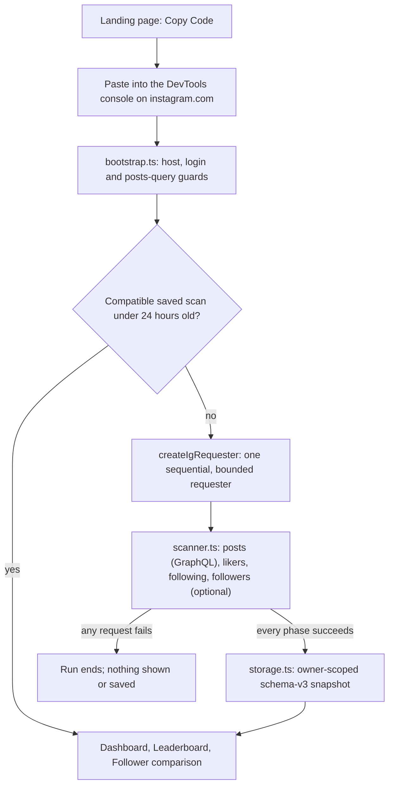

# Instagram Likes Leaderboard


[](LICENSE)
[](https://sagargupta.online/InstagramLikesLeaderboard/)

A browser-console tool that builds a leaderboard from the liker identities Instagram returns for your recent posts. It can also show displayed post-like totals and optionally compare follower/following lists.

> [!WARNING]
> This project uses Instagram's private web endpoints. Fixed conservative pacing reduces request pressure, but no delay or implementation can guarantee avoiding throttling, checkpoints, temporary restrictions, or enforcement. Use it at your own risk.

## Use

You need a desktop browser (Chrome, Edge, Firefox, or Safari) with developer tools. Phone browsers have no console to paste the code into.

1. Open the [tool page](https://sagargupta.online/InstagramLikesLeaderboard/) and select **Copy Code**.
2. Sign in at [instagram.com](https://www.instagram.com/) and open your own profile page (`instagram.com/your_username/`). The tool reads the posts query Instagram's profile page uses, so it will not start from other pages.
3. Open the browser developer console:
   - Windows/Linux: `Ctrl + Shift + J`
   - macOS: `Cmd + Option + J`
   - Safari: turn on **Show features for web developers** in Settings > Advanced first, then press `Cmd + Option + C`
4. Paste the copied code and press Enter.
5. Choose the optional views you need, then select **Start scan**.
6. Keep the tab open until the scan completes. Use **Pause** to prevent the next request or **Stop** to abort the run.

Follower comparison is off by default because it adds requests for your followers list. A scan always reads posts, returned liker identities, and the following list so it can separate people you follow from people you do not. A compatible endpoint-complete or genuine 150-post-limited scan for the same account is reused for 24 hours without contacting Instagram; delete the saved copy to refresh sooner.

## Understand the Results

Instagram's endpoints do not provide one complete, documented dataset. The UI and exports distinguish these values:

- **Displayed post likes:** the like count attached to each returned post. Dashboard totals and averages use these counts.
- **Identified likes:** liker identities returned by the per-post liker endpoint. Leaderboard counts and participation percentages use these identities.
- **No identified likes:** no identity was returned for that account in the scanned posts; this does not prove that the account never liked a post.
- **Recent-post limit:** post pages follow Instagram's continuation cursors until the endpoint finishes or 150 unique posts are collected. Results state when the 150-post bound was reached.
- **Relationship scope:** following and optional follower pages follow Instagram's continuation cursors until each endpoint finishes, subject to the global request/time safety bounds.

The liker endpoint is not paginated by this tool because its continuation behavior is undocumented and additional calls increase account risk. Consequently, identified-like totals can be lower than displayed post-like totals.

## Request Safety and Bounds

Every run uses one sequential requester. Users cannot lower its timing:

| Control | Behavior |
|---|---|
| Request gap | Random 2-3 seconds between request starts |
| Request timeout | 20 seconds, then the run stops |
| Transient retry | One retry for network errors and HTTP 408/500/502/503/504 |
| Retry delay | 5 seconds, or a server delay capped at 60 seconds |
| Auth/challenge/rate limit | No retry; the run stops immediately |
| Maximum run | 250 requests or 15 minutes |
| Post scope | Cursor-to-terminal traversal, capped at 150 unique posts |
| Follower/following scope | Cursor-to-terminal traversal within the global run bounds |

Reaching 150 posts completes with a clearly labeled recent scope. Relationship collection completes only when Instagram stops returning a continuation cursor. A repeated/malformed cursor, unexpected response, missing login, timeout, Stop action, or exhausted request/time bound ends the entire run. Failed scans are never shown or saved. A 429/feedback response blocks new scans in this tab until the provided or conservative fallback retry time; a compatible cached scan can still load. The block lives only in the open tab: reloading the page or pasting the code again clears it, so wait out the time shown before you retry.

The 250-request bound is shared by every phase. A 150-post scan spends about 163 requests on posts and likers (13 post pages of 12, then one liker call per post), which leaves about 87 pages for the following and follower lists combined. Retried requests count against the same bound. A large account with follower comparison on can run out of requests, and the run then saves nothing. Turning follower comparison off skips only the follower list; the following list always runs, so an account that follows a lot of people can still hit the bound.

## Privacy and Saved Data

- The landing page loads no analytics, external fonts, or other third-party scripts.
- The injected app sends requests directly from your browser to Instagram using your existing session. There is no project-operated API or data-collection server.
- Credentials and session cookies are not copied into saved results.
- A completed scan is saved under `ill_scan_results` in Instagram's local storage.
- Schema-v3 saved data is validated at runtime and scoped to the captured Instagram account ID. Data from another account or an older schema is not loaded.
- Selecting Start reuses a compatible snapshot completed less than 24 hours ago before any requester is created. Automatic reuse requires endpoint-complete relationship lists and either endpoint-complete posts or a genuine 150-post scope; follower comparison also requires endpoint-complete follower data.
- The 24-hour limit applies to automatic reuse. **Load saved scan** can still open an older valid snapshot.
- Opaque relationship cursors are never persisted, resumed, or merged. After cache expiry, a fresh endpoint traversal atomically replaces the snapshot only after every enabled phase succeeds.
- Use **Delete saved copy** to remove the local result or force an earlier refresh. Clearing Instagram site data also removes it.

## Views

- **Leaderboard:** returned liker identities split into accounts positively matched in the returned following pages and accounts without a match, with local search, filters, sort, pagination, and CSV/JSON exports. A complete following list retains the usual follow/non-follow labels.
- **Dashboard:** posts scanned, displayed post likes, average displayed likes, identified likers, highest displayed like count, an audience breakdown of identified likers, and the top 5 to 50 identified likers among accounts you follow or everyone.
- **Follower comparison (optional):** accounts that do not follow you back, accounts you do not follow back, mutuals, and followers with no identified likes in the scanned scope, with sort, hide, and CSV export. Manually loaded legacy page-limited snapshots retain qualified unmatched labels; they are not reused automatically.

Filters are shared across all three views and run locally on the saved scan: hide verified accounts, hide accounts without a profile photo, public or private accounts only, follows you or not (with follower comparison), and identified-like thresholds. Privacy and profile-photo filters need a scan made with this version; older saved scans lack those fields. Follower counts are not available: Instagram's liker and relationship lists omit them, and fetching every profile would add hundreds of requests.

## How It Works



The landing page embeds one production bundle. `src/bootstrap.ts` refuses to load the app unless it is on `www.instagram.com`, a session is signed in, and the profile page's posts query is available. `src/main.tsx` then checks for a reusable saved scan before it creates a requester, so a cached result never contacts Instagram.

### Engineering Decisions

- **One sequential requester per run.** `createIgRequester()` in `src/utils/utils.ts` rejects concurrent calls, waits on the pause gate before every fetch, enforces the fixed policy in `src/constants/constants.ts`, and lets Stop abort delays and in-flight requests through an `AbortController`.
- **Fail closed on partial data.** `src/utils/scanner.ts` never catches an error to keep going. A malformed response, a repeated cursor, or any failed request ends the run, and the half-built result is thrown away.
- **Owner-scoped, validated cache.** `src/utils/storage.ts` checks the schema version, every field, and the captured account ID at runtime before it loads a snapshot. Leaderboards and totals are recomputed on load rather than stored.
- **CSV formula-injection guard.** Exported cells that start with `=`, `+`, `-`, `@`, a tab, or a carriage return get a leading `'` so spreadsheets do not run them as formulas.
- **Auditable embedded bundle.** `scripts/update-index.js` writes `dist/dist.js` between two markers in `public/index.html`. `npm run check:generated` rebuilds and fails CI when the embedded copy is stale, so the published page always matches `src/`.

## Development

Requirements: Node 24 (`.nvmrc`) and npm/package-lock.

```bash
npm ci
npm run check
npm run build
```

| Command | Purpose |
|---|---|
| `npm run dev` | Build/embed once, then start Webpack's development server |
| `npm run build:bundle` | Produce `dist/dist.js` |
| `npm run embed` | Embed the bundle into `public/index.html` |
| `npm run build` | Production bundle plus embedding |
| `npm run check:generated` | Fail if the embedded bundle is stale |
| `npm run lint` | Lint TypeScript/TSX source and typed tests |
| `npm run typecheck` | Type-check source and typed tests without emitting |
| `npm test` | Run Node tests through `tsx` |
| `npm run check` | Run lint, typecheck, tests, and generated-file parity |

The app remains a single Preact/TypeScript/Webpack bundle. Tests use mocked transports and in-memory storage; they do not issue live Instagram requests. Pull requests run CI, while pushes to `main` build and deploy `public/` to GitHub Pages.

## Acknowledgements

The layout started from [davidarroyo1234/InstagramUnfollowers](https://github.com/davidarroyo1234/InstagramUnfollowers) (MIT), a console-paste tool for finding accounts that do not follow you back.

## Legal

This project is not affiliated with, endorsed by, or officially connected to Instagram or Meta. Instagram can change or remove the private endpoints at any time.

Licensed under the [MIT License](LICENSE).
